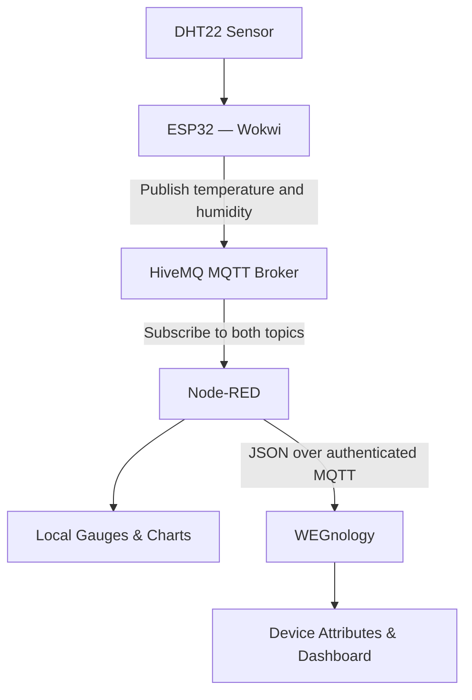
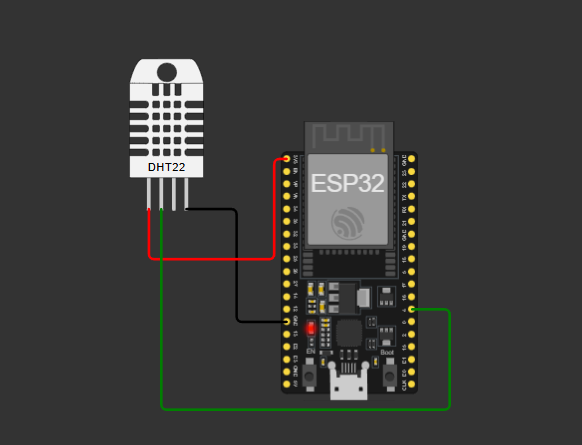
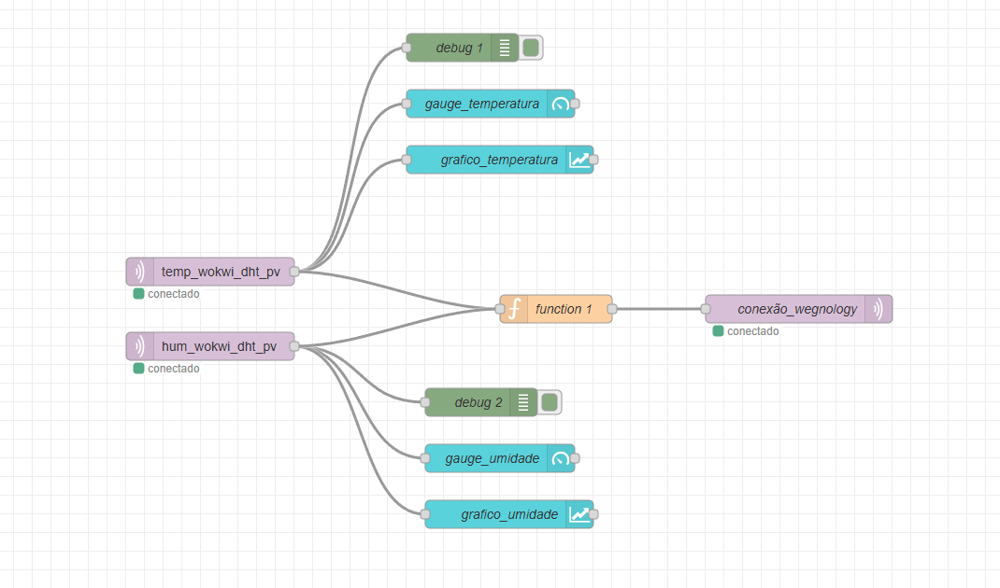
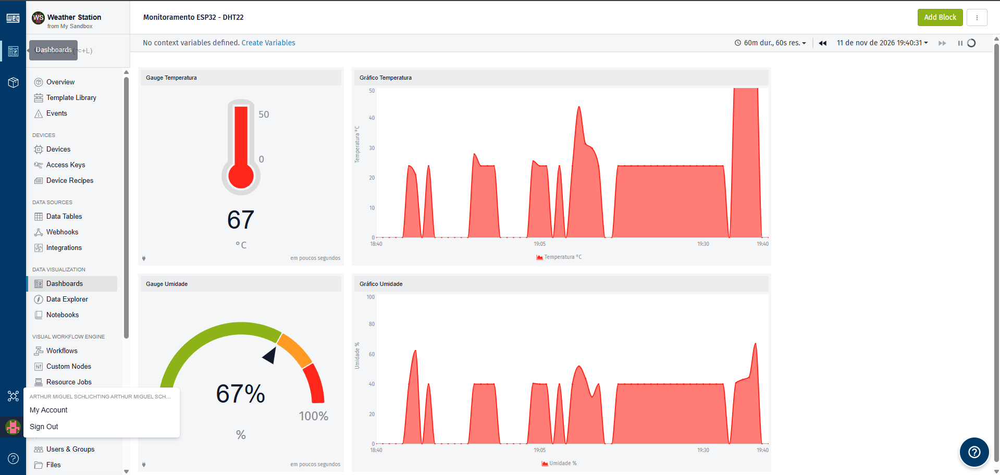

<div align="center">

# 🌡️ ESP32 DHT22 — IoT Monitoring System

**Real-time temperature and humidity monitoring with Wokwi, MQTT, Node-RED and WEGnology.**


</div>

---

## 📖 Overview

This project demonstrates an **Internet of Things (IoT)** solution for collecting, transmitting, processing, and visualizing environmental data.

An **ESP32** and a **DHT22** sensor are simulated in **Wokwi**. The ESP32 publishes temperature and humidity readings to the **HiveMQ public MQTT broker**. **Node-RED** subscribes to these messages, displays the data on a local dashboard, and forwards the readings to **WEGnology** for device monitoring and historical visualization.

> **Note:** The hardware runs in a simulator. The same overall architecture can be adapted to a physical ESP32 and DHT22 sensor.

## 📑 Table of Contents

- [Features](#-features)
- [Technologies](#-technologies)
- [System Architecture](#-system-architecture)
- [Project Structure](#-project-structure)
- [Circuit and Wiring](#-circuit-and-wiring)
- [MQTT Communication](#-mqtt-communication)
- [Node-RED Flow](#-node-red-flow)
- [WEGnology Integration](#-wegnology-integration)
- [How to Run](#-how-to-run)
- [Results](#-results)
- [Security Notes](#-security-notes)
- [Conclusion](#-conclusion)

## ✨ Features

- 🌡️ Read **temperature (°C)** and **relative humidity (%)** using a DHT22 sensor.
- 📡 Publish sensor data over **MQTT** approximately every **2 seconds**.
- 🔄 Receive, process, and forward messages with **Node-RED**.
- 📊 Display live values using **gauges** and **time-series charts**.
- ☁️ Send telemetry to **WEGnology** using a separate authenticated MQTT connection.
- 🕒 View measurements and historical trends in the WEGnology dashboard.

## 🛠️ Technologies

| Technology | Role |
|:--|:--|
| **ESP32** | Microcontroller that reads and publishes sensor data |
| **DHT22** | Temperature and humidity sensor |
| **Wokwi** | Virtual hardware simulation |
| **C++ / Arduino** | ESP32 firmware |
| **Wi-Fi** | Network connectivity from the simulated ESP32 |
| **MQTT** | Lightweight publish/subscribe messaging protocol |
| **HiveMQ** | Public MQTT broker used by the ESP32 and Node-RED |
| **Node-RED** | Flow-based processing and local dashboard |
| **WEGnology** | IoT device attributes, cloud dashboards, and data history |

## 🏗️ System Architecture



**Data flow:** `DHT22 → ESP32 (Wokwi) → HiveMQ → Node-RED → WEGnology`

## 📁 Project Structure

The repository can be organized as follows:

```text
esp32-dht22-iot-monitoring/
├── wokwi/
│   ├── sketch.ino          # ESP32 firmware
│   ├── diagram.json        # Wokwi circuit configuration
│   └── libraries.txt       # External library dependencies
├── node-red/
│   └── flow.json           # Exported Node-RED flow (no secrets)
├── docs/
│   ├── circuito.png        # Wokwi circuit screenshot
│   ├── node-red.png        # Node-RED flow screenshot
│   └── wegnology.png       # WEGnology dashboard screenshot
└── README.md
```

> Add the exported files and screenshots to these folders. If you use different filenames, update the image paths below.

## 🔌 Circuit and Wiring

The **DHT22** sensor is connected to the **ESP32** in Wokwi.

| DHT22 Pin | ESP32 Connection | Purpose |
|:--|:--|:--|
| VCC | 3V3 | Power |
| DATA | GPIO 4 | Sensor readings |
| GND | GND | Ground |



The ESP32 firmware initializes the DHT22 sensor, connects to the Wokwi Wi-Fi network, and periodically publishes the readings.

## 📡 MQTT Communication

### HiveMQ configuration

| Parameter | Value |
|:--|:--|
| Broker | `broker.hivemq.com` |
| Port | `1883` |
| ESP32 Client ID | `ESP32_DHT22_WOKWI` |
| Temperature topic | `temp_wokwi_dht_pv` |
| Humidity topic | `hum_wokwi_dht_pv` |

The ESP32 publishes the measurements as numeric strings:

```text
Topic: temp_wokwi_dht_pv
Payload: 25.50

Topic: hum_wokwi_dht_pv
Payload: 65.2
```

### Firmware behavior

| Function | Responsibility |
|:--|:--|
| `connect_wifi()` | Connects the ESP32 to Wi-Fi |
| `reconnect_MQTT()` | Reconnects to the MQTT broker if necessary |
| `captura_dht()` | Reads the DHT22 and publishes both measurements |
| `setup()` | Initializes the sensor, serial monitor, Wi-Fi, and MQTT server |
| `loop()` | Checks connections, processes MQTT, and reads the sensor |

## 🔀 Node-RED Flow

Node-RED subscribes to the two HiveMQ topics and uses the received values in two ways:

1. **Local visualization:** each `mqtt in` node connects to a `debug`, a `gauge`, and a `chart` node.
2. **Cloud integration:** a `function` node prepares the readings as JSON, and an `mqtt out` node publishes them to WEGnology.



**Node types used:** `mqtt in`, `debug`, `ui_gauge`, `ui_chart`, `function`, and `mqtt out`.

The JSON payload sent to WEGnology follows this structure:

```json
{
  "data": {
    "temperatura": 25.50,
    "umidade": 65.2
  }
}
```

> The temperature is stored temporarily in Node-RED so it can be combined with the latest humidity value before publication. These values are not guaranteed to have identical timestamps.

## ☁️ WEGnology Integration

A **Standalone Device** named `ESP32_DHT22_Wokwi` is registered in WEGnology with the following attributes:

| Attribute | Type | Unit |
|:--|:--|:--|
| `temperatura` | Number | °C |
| `umidade` | Number | % |

### WEGnology MQTT connection

| Parameter | Configuration |
|:--|:--|
| Broker | `broker.app.wnology.io` |
| Port | `8883` (TLS) |
| Client ID | Your WEGnology Device ID |
| Username | Your Access Key |
| Password | Your Access Secret |
| Publish topic | `wnology/<DEVICE_ID>/state` |
| Payload | JSON with a `data` object |

The WEGnology dashboard can include:

- **Temperature Gauge** — current temperature in °C.
- **Humidity Gauge** — current relative humidity in %.
- **Temperature Time Series** — temperature changes over time.
- **Humidity Time Series** — humidity changes over time.



## 🚀 How to Run

### 1. Run the Wokwi simulation

1. Open the project in [Wokwi](https://wokwi.com/).
2. Load `sketch.ino`, `diagram.json`, and the required libraries from the `wokwi/` folder.
3. Start the simulation.
4. Check the serial monitor for successful Wi-Fi and MQTT connections and sensor readings.

### 2. Import the Node-RED flow

1. Start Node-RED and open its editor.
2. Install any missing dashboard nodes used in the exported flow.
3. Open **Menu → Import**, select `node-red/flow.json`, and import it.
4. Configure the HiveMQ broker for the two `mqtt in` nodes.
5. Confirm that both MQTT topics match the ones defined in the ESP32 firmware.

### 3. Configure WEGnology

1. Create an application and a **Standalone Device**.
2. Add the numeric attributes `temperatura` and `umidade`.
3. Create an Access Key authorized to publish data for that device.
4. In Node-RED, configure the WEGnology `mqtt out` broker with **TLS**, Device ID, Access Key, and Access Secret.
5. Update the outgoing MQTT topic with the Device ID.
6. Click **Deploy** in Node-RED.

### 4. Check the dashboards

1. Verify that the Node-RED gauges and charts are receiving readings.
2. Confirm that the WEGnology device attributes are updating.
3. Create WEGnology dashboard blocks linked to those attributes.
4. Change the simulated DHT22 values in Wokwi to test the updates.

## 📊 Results

The system demonstrates end-to-end data communication from simulated hardware to an IoT platform:

- The **ESP32** captures temperature and humidity readings.
- **HiveMQ** distributes the MQTT messages.
- **Node-RED** processes and visualizes incoming data.
- **WEGnology** receives and displays the measurements in its dashboards.

## 🔒 Security Notes

- **Do not commit** WEGnology Access Keys, Access Secrets, passwords, or other tokens.
- Review `flow.json` before pushing: Node-RED exports may contain broker settings or other sensitive configuration.
- Store credentials in your local environment or a secure secrets manager, not in this repository.
- The **public HiveMQ broker** is suitable for demonstrations, not for transmitting confidential information.
- Use **TLS** for the WEGnology MQTT connection.

## ✅ Conclusion

This project brings together **embedded programming, IoT protocols, flow-based processing, and cloud monitoring**. It demonstrates how data collected by a simulated ESP32 can be transmitted using MQTT, processed in Node-RED, and monitored through the WEGnology platform.

---

<div align="center">

**Built for learning and experimenting with IoT.**

</div>